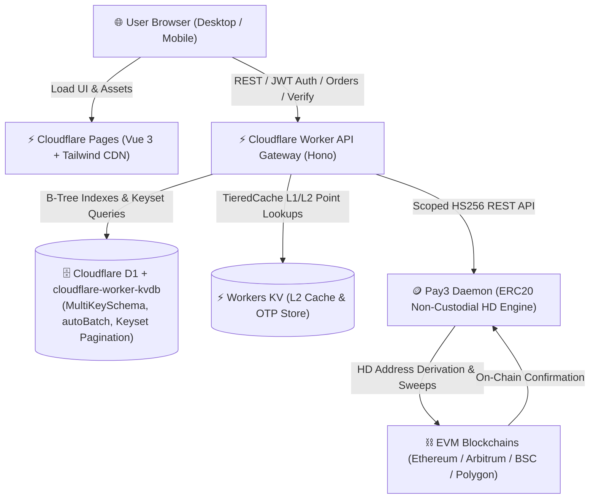

# GoChina Portal (GoChina 数字化服务与订阅门户系统)

[](https://workers.cloudflare.com/)
[](https://pages.cloudflare.com/)
[](https://github.com/xzsean666/cloudlflare-worker-kvdb)
[](https://github.com/xzsean666/pay3)
[](./test)

> **GoChina** is a next-generation Serverless Web Portal & Subscription Platform engineered natively for the **Cloudflare Serverless Ecosystem** (Cloudflare Workers, Pages, D1, Workers KV, and R2) with non-custodial crypto checkout and automated edge digital entitlement delivery.

---

## 1. System Architecture

The entire platform runs edge-natively on Cloudflare infrastructure without traditional long-running Node.js backend servers:



---

## 2. Core Platform Capabilities

### ⚡ Edge-Native Architecture
- **API Gateway**: Built on [Hono](https://hono.dev/) on Cloudflare Workers (`workerd` runtime) with global sub-50ms latency across 300+ edge data centers.
- **Frontend SPA**: Vue 3 + Vite + Tailwind CSS + Lucide Icons deployed to Cloudflare Pages CDN with dark/light themes and multi-language support (English, 简体中文, 日本語).

### 🗄️ Database & Tiered Storage (`cloudflare-worker-kvdb`)
- **Declarative Schema**: Schema definition via `MultiKeySchema` on Cloudflare D1 (SQLite) with auto-generated physical columns and B-Tree secondary indexing.
- **O(1) Point Queries**: `table.getBy('email', email)` and `table.getBy('token', token)` with zero SQL string concatenation.
- **Keyset Pagination**: No offset overhead with `table.findPage({ limit, after: cursor })`.
- **Write Micro-Batching**: `autoBatch` coalesces high-frequency mutations (50 writes / 50ms window) to conserve D1 transaction quotas.
- **Multi-Tier Caching**: `TieredCache` combining L1 Worker memory LRU and L2 Workers KV for sub-millisecond catalog reads.

### 🪙 Non-Custodial Crypto Payment Gateway (`pay3`)
- **HD Child Address Derivation**: Unique deposit address per checkout order.
- **Scoped HS256 JWT Authentication**: Granular scopes (`orders:create`, `orders:read`, `orders:verify`, `wallets:create`).
- **Dual Verification Engine**:
  - **Instant Verification**: User-triggered `/verify` endpoint performs immediate blockchain scan via Pay3 daemon.
  - **Cron Sweeper Reconciliation**: Workers Cron Trigger automatically sweeps and fulfills pending orders every 5 minutes.

### 🔑 Automated Digital Entitlement Delivery
- Instant entitlement provisioning upon payment verification.
- Cryptographically secure bearer access token (`goc_live_...`).
- Quota tracking (bandwidth bytes & API call limits) with atomic decrement and overage protection.
- QR Code display for quick import into Clash, Sing-box, and V2Ray clients.

---

## 3. Directory Layout

```
GoChina/
├── src/                          # Cloudflare Workers Backend
│   ├── index.ts                  # Worker entrypoint (fetch + scheduled cron)
│   ├── controllers/              # Hono REST controllers (auth, plans, orders, entitlements, admin)
│   ├── cron/                     # Background sweeper reconciliation
│   ├── db/                       # KVDB client initialization & database seeds
│   ├── middleware/               # Bearer JWT auth & RBAC middleware
│   ├── pay3/                     # Pay3 client & scoped JWT provider
│   ├── router/                   # Hono router composition & CORS
│   ├── services/                 # Domain business services (auth, plan, order, verification, entitlement)
│   └── types/                    # Domain models & database schema interfaces
├── frontend/                     # Cloudflare Pages Web UI (Vue 3 + Vite)
│   ├── src/
│   │   ├── api/                  # Typed REST API client
│   │   ├── components/           # UI components (auth, plans, checkout, dashboard, admin, layout)
│   │   ├── composables/          # Reusable composables (toast, countdown, order polling, theme, i18n)
│   │   ├── router/               # Vue Router navigation
│   │   ├── stores/               # Pinia reactive auth & session store
│   │   ├── views/                # Top-level views (Home, Dashboard, Admin)
│   │   └── App.vue               # Responsive application shell
│   └── test/                     # Frontend Vitest test suites
├── scripts/                      # Deployment & Operations Automation
│   ├── deploy-worker.sh          # Cloudflare Workers release script
│   ├── deploy-pages.sh           # Cloudflare Pages release script
│   └── seed.ts                   # KVDB database seed script
├── test/                         # Backend Vitest Test Harness
│   ├── mocks/                    # Mock Pay3 daemon & Mock D1/KV in-memory drivers
│   ├── e2e.test.ts               # End-to-End integration test suite
│   └── setup.ts                  # node:sqlite based D1 test setup
├── wrangler.jsonc                # Cloudflare Workers & D1/KV configuration
└── package.json                  # Root monorepo workspace configuration
```

---

## 4. Environment Variables & Secrets Checklist

Configure these in Cloudflare Dashboard or via `wrangler secret put <KEY>`:

| Variable Name | Type | Description | Example / Default |
|---|---|---|---|
| `ENVIRONMENT` | Var | Deployment environment (`development` / `production`) | `production` |
| `DB` | D1 Binding | Cloudflare D1 database binding | `gochina-db` |
| `CACHE_KV` | KV Binding | Workers KV namespace for caching & OTP codes | `gochina-cache-kv` |
| `PORTAL_JWT_SECRET` | Secret | Secret key used for signing portal session JWTs | `openssl rand -hex 32` |
| `PAY3_BASE_URL` | Var | URL of the Pay3 payment daemon REST API | `https://pay3.internal.domain` |
| `PAY3_JWT_SECRET` | Secret | Shared HMAC secret for scoped Pay3 JWT tokens | `openssl rand -hex 32` |

---

## 5. Local Development & Testing

### Prerequisites
- Node.js >= 22.0.0
- `pnpm` >= 10.0.0
- Cloudflare Wrangler CLI (`pnpm install -g wrangler`)

### Installation
```bash
git clone https://github.com/xzsean666/GoChina.git
cd GoChina
pnpm install
```

### Run Tests
```bash
# Run backend test suite (55 tests including E2E)
pnpm test

# Run frontend test suite (13 tests)
pnpm --dir frontend test

# Run type checks across both backend and frontend
pnpm typecheck
pnpm --dir frontend typecheck
```

### Local Dev Server
```bash
# Start backend Cloudflare Worker locally (port 8787)
pnpm dev

# In another terminal, start frontend Vite dev server (port 5173)
pnpm --dir frontend dev
```

---

## 6. Cloudflare Deployment Runbook

### Step 1: Deploy Cloudflare Workers Backend
```bash
# Verify dry-run build
bash scripts/deploy-worker.sh --dry-run

# Production deploy
bash scripts/deploy-worker.sh
```

### Step 2: Seed KVDB Schema & Initial Plans
```bash
pnpm seed
```

### Step 3: Deploy Cloudflare Pages Frontend
```bash
# Verify dry-run build
bash scripts/deploy-pages.sh --dry-run

# Production deploy
bash scripts/deploy-pages.sh
```

---

## 7. Operations & Monitoring

- **Health Probes**: `GET /health` and `GET /healthz` for edge uptime monitoring.
- **Admin Audit Panel**: Log in with an administrator account (`admin@gochina.io`) to inspect live Pay3 child address allocations, transaction hashes, and on-chain block scan statuses.
- **Workers Cron Monitor**: Check Cloudflare Dashboard -> Workers -> Triggers to observe scheduled sweeper execution (`*/5 * * * *`).

---

## 8. License
MIT License. Copyright (c) GoChina Portal Engineering Team.
