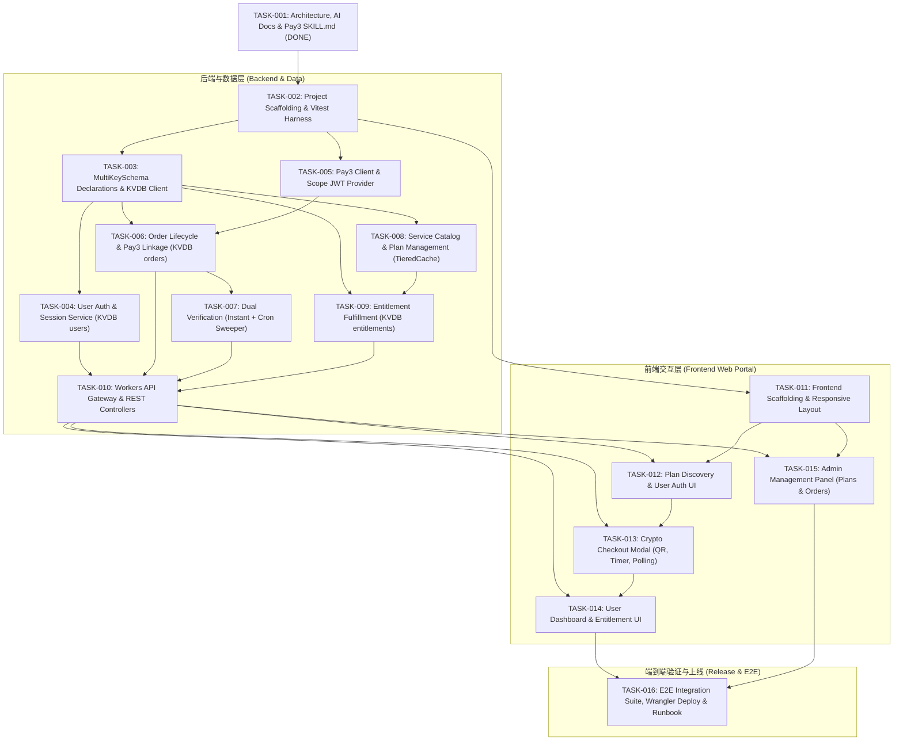

# TASK_INDEX.md — Task Index & Engineering Roadmap (Comprehensive 16-Task Matrix)

This document catalogs the complete engineering task breakdown for `GoChina`. Each task strictly satisfies the 30-90 minute single-focus constraint, strict file boundaries, explicit acceptance criteria, and verification commands defined in [`docs/AI_AGENT_PROMPT.md`](file:///ssd0/git/GoChina/docs/AI_AGENT_PROMPT.md).

---

## 1. Complete Task Matrix (16 Granular Tasks)

| Task ID | Module | Title | Dependencies | Status | Est. Time | Key Deliverable |
| :--- | :--- | :--- | :--- | :--- | :--- | :--- |
| [TASK-001](file:///ssd0/git/GoChina/docs/AI/tasks/TASK-001.md) | **Governance** | Architecture Spec, Internal SDK Skill Generation & AI Documentation Governance Framework | None | **DONE** | 60 min | Full AI docs, portal architecture spec, Pay3 SKILL.md, roadmap |
| [TASK-002](file:///ssd0/git/GoChina/docs/AI/tasks/TASK-002.md) | **Scaffold** | Monorepo/Workspace Scaffolding, TypeScript/Workers Build Config & Vitest Test Harness | TASK-001 | **DONE** | 45 min | `package.json`, `tsconfig.json`, `wrangler.jsonc`, Miniflare harness |
| [TASK-003](file:///ssd0/git/GoChina/docs/AI/tasks/TASK-003.md) | **Database** | Domain Models, MultiKeySchema Declarations & `cloudflare-worker-kvdb` Client | TASK-002 | **DONE** | 60 min | Schema Tables (users, plans, orders, entitlements), Multi-Key B-Tree indexes, Auto-Batch |
| [TASK-004](file:///ssd0/git/GoChina/docs/AI/tasks/TASK-004.md) | **Backend Auth** | User Authentication & Session Service (Passwordless OTP / Web3 & Auth Middleware) | TASK-003 | **DONE** | 60 min | User session JWT issuance, auth middleware, KVDB users table O(1) getBy |
| [TASK-005](file:///ssd0/git/GoChina/docs/AI/tasks/TASK-005.md) | **Pay3 Gateway** | Pay3 Integration Client, Scope JWT Provider & Mock Test Harness | TASK-002 | **DONE** | 60 min | `Pay3Client`, HS256 JWT provider, mock fetch server, typed errors |
| [TASK-006](file:///ssd0/git/GoChina/docs/AI/tasks/TASK-006.md) | **Backend Order** | Order Lifecycle, Checkout Flow & Idempotent Pay3 Linkage | TASK-003, TASK-005 | **DONE** | 60 min | `OrderService`, external_id generation, Pay3 address allocation & KVDB orders table |
| [TASK-007](file:///ssd0/git/GoChina/docs/AI/tasks/TASK-007.md) | **Pay3 Verify** | Dual Verification Engine (Instant Verify Handler & Scheduled Cron Sweeper Worker) | TASK-006 | **DONE** | 60 min | Direct RPC verify handler, KVDB indexed Cron sweeper, auto-fulfillment |
| [TASK-008](file:///ssd0/git/GoChina/docs/AI/tasks/TASK-008.md) | **Plan Catalog** | Service Catalog & Plan Management Service | TASK-003 | **DONE** | 45 min | `PlanService`, KVDB TieredCache (L1/L2) sub-ms read acceleration |
| [TASK-009](file:///ssd0/git/GoChina/docs/AI/tasks/TASK-009.md) | **Fulfillment** | Entitlement Fulfillment Engine & Usage Tracking Service | TASK-003, TASK-008 | **DONE** | 60 min | `EntitlementService`, auto-provisioning, quota tracking, KVDB entitlements table |
| [TASK-010](file:///ssd0/git/GoChina/docs/AI/tasks/TASK-010.md) | **API Gateway** | Cloudflare Workers API Gateway, Routing & REST Controllers | TASK-004, TASK-006, TASK-007, TASK-009 | **DONE** | 60 min | Hono/Worker dispatcher, CORS, public/user/admin REST controllers |
| [TASK-011](file:///ssd0/git/GoChina/docs/AI/tasks/TASK-011.md) | **Frontend Base** | Frontend Scaffolding, Responsive Layout & Tailwind Design System (Pages) | TASK-002 | **DONE** | 45 min | Vite + Vue 3 / React, Tailwind CSS, Navigation, responsive shell |
| [TASK-012](file:///ssd0/git/GoChina/docs/AI/tasks/TASK-012.md) | **Frontend Plans** | Frontend Plan Discovery & User Authentication UI | TASK-010, TASK-011 | **DONE** | 60 min | Pricing cards, feature breakdown, email OTP / wallet connect modal |
| [TASK-013](file:///ssd0/git/GoChina/docs/AI/tasks/TASK-013.md) | **Frontend Pay** | Frontend Interactive Crypto Checkout Modal (QR Code, Countdown & Polling) | TASK-010, TASK-012 | **DONE** | 60 min | Deposit address QR code, copy button, live countdown, polling & verify button |
| [TASK-014](file:///ssd0/git/GoChina/docs/AI/tasks/TASK-014.md) | **Frontend User** | Frontend User Dashboard & Entitlement Management UI | TASK-010, TASK-013 | **DONE** | 60 min | Active services, quota progress bar, expiry indicator, credentials view |
| [TASK-015](file:///ssd0/git/GoChina/docs/AI/tasks/TASK-015.md) | **Frontend Admin** | Frontend Admin Management Panel (Plans, Orders Audit & Pay3 Diagnostics) | TASK-010, TASK-011 | **DONE** | 60 min | Admin UI for plans management, order audit, Pay3 transaction inspection |
| [TASK-016](file:///ssd0/git/GoChina/docs/AI/tasks/TASK-016.md) | **Release** | End-to-End Integration Test Suite, Wrangler Deployment & Release Runbook | TASK-014, TASK-015 | **DONE** | 60 min | Full flow E2E tests, KVDB seed verify, Pages & Worker deploy, release docs |
| [TASK-017](file:///ssd0/git/GoChina/docs/AI/tasks/TASK-017.md) | **Design System** | Design System Elevation: Typography, Obsidian-Cyber Palette, Noise & Glass Layout Shell | TASK-011 | **DONE** | 60 min | Google Fonts (Outfit + Plus Jakarta Sans + JetBrains Mono), obsidian theme, tactile noise, floating glass navbar & elevated layout shell |
| [TASK-018](file:///ssd0/git/GoChina/docs/AI/tasks/TASK-018.md) | **Landing & Plans** | Landing Page & Pricing Matrix Elevation (Hero, Edge Architecture & Plan Cards) | TASK-017 | **DONE** | 60 min | Asymmetric hero, live edge telemetry, tier visual hierarchy, Pro glow card |
| [TASK-019](file:///ssd0/git/GoChina/docs/AI/tasks/TASK-019.md) | **Crypto Checkout** | Web3 Crypto Checkout Experience & Auth Modal Visual Overhaul | TASK-017 | **DONE** | 60 min | QR code with scanner reticle, animated countdown ring, listening pulse, auth tabs |
| [TASK-020](file:///ssd0/git/GoChina/docs/AI/tasks/TASK-020.md) | **Dashboard & Admin** | User Dashboard & Admin Management Panel Visual Elevation | TASK-017 | **DONE** | 60 min | Rich stat widgets, precision SVG quota gauge, credential modal, high-density admin tables |
| [TASK-021](file:///ssd0/git/GoChina/docs/AI/tasks/TASK-021.md) | **Visual E2E** | Full-Flow Visual E2E Test Suite & Comprehensive Screenshot Capture | TASK-016, TASK-020 | **DONE** | 60 min | Automated headless Chrome runner, all pages/flows covered, 14 screenshots in docs/screenshots/ |
| [TASK-022](file:///ssd0/git/GoChina/docs/AI/tasks/TASK-022.md) | **Web3 Auth Only** | Web3-Only Authentication & Removal of Email Registration | TASK-021 | **DONE** | 45 min | Pure Web3 wallet ECDSA signature auth, email OTP disabled, updated visual E2E tests |

---

## 2. Detailed Dependency Graph

---

## 3. 覆盖完整性与自研 SDK 契约自检表 (Completeness & SDK Checklist)

- [x] **数据库全面基于 `cloudflare-worker-kvdb` (Pure KVDB)**：
  - 彻底摒弃手写裸 D1 SQL 迁移，全量声明 `MultiKeySchema` ([`TASK-003`](file:///ssd0/git/GoChina/docs/AI/tasks/TASK-003.md))
  - 开启 `autoBatch` 微批写聚合与单语句 100 参数安全切片，杜绝 D1 单主写锁死 ([`TASK-003`](file:///ssd0/git/GoChina/docs/AI/tasks/TASK-003.md))
  - 高频点查字段全部挂载物理 B-Tree 索引，使用 `table.getBy()` 达成 O(1) 毫秒检索 ([`TASK-003`](file:///ssd0/git/GoChina/docs/AI/tasks/TASK-003.md), [`TASK-004`](file:///ssd0/git/GoChina/docs/AI/tasks/TASK-004.md), [`TASK-006`](file:///ssd0/git/GoChina/docs/AI/tasks/TASK-006.md), [`TASK-009`](file:///ssd0/git/GoChina/docs/AI/tasks/TASK-009.md))
  - 订单与记录分页全量使用 Keyset 游标分页 (`table.findPage`)，消除慢 `OFFSET` 账单损耗 ([`TASK-006`](file:///ssd0/git/GoChina/docs/AI/tasks/TASK-006.md))
  - 服务方案使用 KVDB TieredCache (L1 内存 LRU + L2 Workers KV) 达成亚毫秒边缘读取 ([`TASK-008`](file:///ssd0/git/GoChina/docs/AI/tasks/TASK-008.md))
- [x] **支付网关深度对接 `pay3` (Deep Pay3 Integration)**：
  - 严谨实现 HS256 Scoped JWT 签发与轻量 `Pay3Client` ([`TASK-005`](file:///ssd0/git/GoChina/docs/AI/tasks/TASK-005.md))
  - 业务订单 `external_id` 与 Pay3 `POST /v1/orders` 幂等绑定与收款子地址分配 ([`TASK-006`](file:///ssd0/git/GoChina/docs/AI/tasks/TASK-006.md))
  - 双轨履约：用户主动点击 `/verify` 直连扫链 + Workers `scheduled` Cron 批量巡检 ([`TASK-007`](file:///ssd0/git/GoChina/docs/AI/tasks/TASK-007.md))
  - Pay3 异常状态诊断（`late_payment`, `partial_payment`, `problem_payment`）深度追踪 ([`TASK-007`](file:///ssd0/git/GoChina/docs/AI/tasks/TASK-007.md), [`TASK-015`](file:///ssd0/git/GoChina/docs/AI/tasks/TASK-015.md))
- [x] **前端自服务与管理端完整性 (Frontend Web Portal)**：
  - Pages 响应式基础骨架与主题 ([`TASK-011`](file:///ssd0/git/GoChina/docs/AI/tasks/TASK-011.md))
  - 服务与方案卡片、多周期价格换算与登录弹窗 ([`TASK-012`](file:///ssd0/git/GoChina/docs/AI/tasks/TASK-012.md))
  - Web3 加密收银台弹窗（二维码/倒计时/实时状态跳动/即时扫链按钮）([`TASK-013`](file:///ssd0/git/GoChina/docs/AI/tasks/TASK-013.md))
  - 用户控制台、生效中权益与用量进度条 ([`TASK-014`](file:///ssd0/git/GoChina/docs/AI/tasks/TASK-014.md))
  - 管理员管理控制台（方案上下架、订单对账审计与 Pay3 诊断）([`TASK-015`](file:///ssd0/git/GoChina/docs/AI/tasks/TASK-015.md))
- [x] **端到端测试与全自动发布 (E2E & Release)**：
  - Miniflare 边缘环境下全流程购买履约集成测试 ([`TASK-016`](file:///ssd0/git/GoChina/docs/AI/tasks/TASK-016.md))
  - Cloudflare Workers 与 Pages 纯净自动化部署脚本与生产 Runbook ([`TASK-016`](file:///ssd0/git/GoChina/docs/AI/tasks/TASK-016.md))
