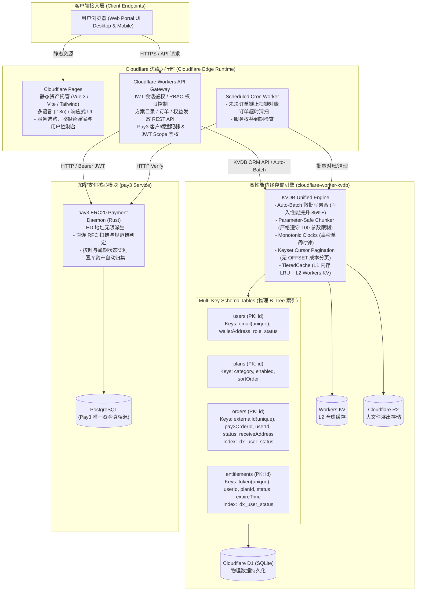
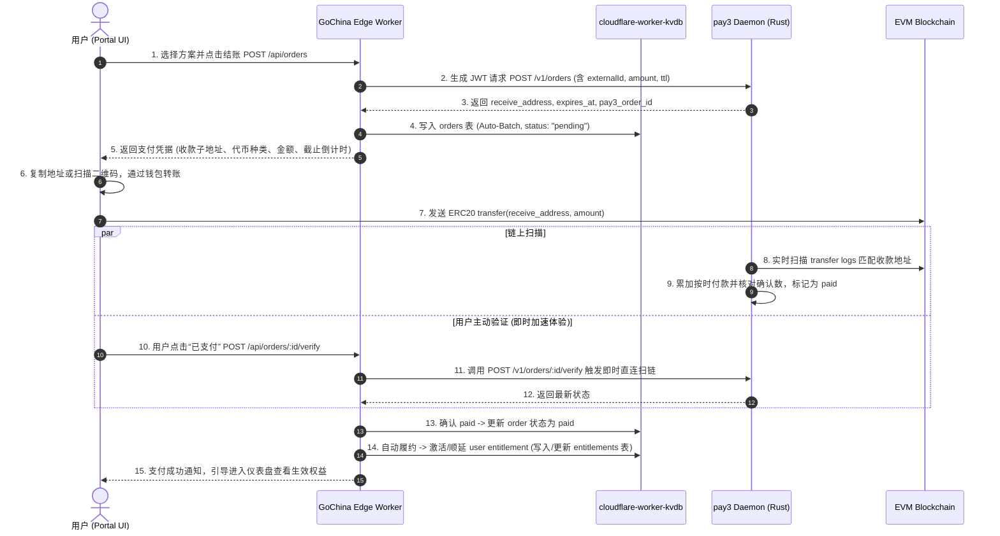

# GoChina Portal 核心架构与系统设计规范 (Portal Architecture Specification)

> **文档标识**：`docs/ARCHITECTURE.PROTAL.md` (同时作为 `docs/AI/ARCHITECTURE.md` 核心事实来源)  
> **适用对象**：系统架构师、前端/边缘端开发者、AI 编程代理  
> **核心技术栈**：Cloudflare Workers / Pages, TypeScript, `cloudflare-worker-kvdb` (原生 Multi-Key 物理索引与 Auto-Batch), `pay3` (ERC20 去中心化支付网关)

---

## 1. 架构总览与拓扑图 (Architecture Overview & Topology)

GoChina 是一个采用 **100% 边缘无服务器架构 (Edge Serverless)** 的现代化数字化服务与订阅门户系统。系统深度依托 Cloudflare 全球边缘生态：
- **前端展示层**：托管于 Cloudflare Pages，基于 Vue 3 + Tailwind CSS 构建现代化全响应式 Web 门户；
- **边缘网关层**：运行于 Cloudflare Workers，提供极速响应的 RESTful API 网关与业务服务；
- **存储与状态真相层**：**100% 由内部自研基础库 [`cloudflare-worker-kvdb`](file:///ssd0/git/cloudlflare-worker-kvdb) 统一纳管**，依托 Cloudflare D1 (SQLite) 与 Workers KV，全量采用 **Multi-Key 物理二级索引**、**Auto-Batch 微批写优化** 与 **Keyset 游标分页**，消除传统 D1 单主写锁冲突与全表扫描性能陷阱；
- **Web3 加密支付网关**：深度集成内部自研服务 [`pay3`](file:///ssd0/git/pay3)，实现单订单单地址 HD 派生、链上 Transfer 直连扫描匹配、规范链防分叉确认与国库资金自动归集。

### 系统架构拓扑图：



---

## 2. 数据库与存储设计：全面基于 `cloudflare-worker-kvdb`

所有数据持久化操作**彻底摒弃手写裸 SQL 迁移**，完全通过 `cloudflare-worker-kvdb` 的 `MultiKeySchema` 契约声明与物理索引机制管理。

### 2.1 全局 KVDB 实例初始化规范
```typescript
import { KVDB } from "cloudflare-worker-kvdb";

export function createDatabase(env: Env, ctx?: ExecutionContext): KVDB {
  return new KVDB({
    d1: env.DB,                     // Cloudflare D1 绑定
    kv: env.KV,                     // Cloudflare Workers KV 绑定 (L2 缓存)
    ctx,                            // Worker 执行上下文 (用于 ctx.waitUntil 异步刷盘)
    autoBatch: {                    // 开启微批写聚合优化
      maxBatchSize: 50,             // 聚合 50 条操作
      flushIntervalMs: 50,          // 50ms 延迟窗口
      maxConcurrentBatches: 5,
    },
  });
}
```

---

### 2.2 四大核心 Multi-Key Schema 表定义

#### 1. 用户表 (`users`)
- **主键**: `id` (string, `usr_` + NanoID)
- **Multi-Key 物理列与索引**:
  ```typescript
  export const userSchema: MultiKeySchema<UserKeys, "string"> = {
    primaryKey: { name: "id", type: "string" },
    timestamps: true,
    keys: {
      email: { type: "string", index: { unique: true } },
      walletAddress: { type: "string", nullable: true, index: true },
      role: { type: "string", default: "user", index: true },
      status: { type: "string", default: "active", index: true },
    },
  };
  ```
- **核心查询场景**:
  - 按邮箱极速点查：`users.getBy("email", email)` -> O(1) 物理索引点查。
  - 按钱包地址登录：`users.getBy("walletAddress", address)`。

#### 2. 服务与方案表 (`plans`)
- **主键**: `id` (string, 如 `plan_starter_monthly`, `plan_pro_yearly`)
- **Multi-Key 物理列与索引**:
  ```typescript
  export const planSchema: MultiKeySchema<PlanKeys, "string"> = {
    primaryKey: { name: "id", type: "string" },
    timestamps: true,
    keys: {
      category: { type: "string", default: "standard", index: true },
      enabled: { type: "integer", default: 1, index: true },
      sortOrder: { type: "integer", default: 0, index: true },
    },
  };
  ```
- **核心查询场景**:
  - 公开展示上架方案：`plans.find({ enabled: 1 })` -> 物理索引过滤，结合 L1/L2 缓存微秒级返回。

#### 3. 订单表 (`orders`)
- **主键**: `id` (string, `ord_` + NanoID)
- **Multi-Key 物理列与索引**:
  ```typescript
  export const orderSchema: MultiKeySchema<OrderKeys, "string"> = {
    primaryKey: { name: "id", type: "string" },
    timestamps: true,
    keys: {
      externalId: { type: "string", index: { unique: true } }, // 对接 Pay3 的幂等业务号
      pay3OrderId: { type: "string", index: true },            // Pay3 内部 UUID
      userId: { type: "string", index: true },                 // 所属用户
      status: { type: "string", default: "pending", index: true },
      receiveAddress: { type: "string", index: true },         // Pay3 派生的收款子地址
    },
    indexes: [
      { name: "idx_user_status", keys: ["userId", "status"] },
      { name: "idx_status_created", keys: ["status", "created_at"] },
    ],
  };
  ```
- **核心查询场景**:
  - Pay3 回调/验证对账：`orders.getBy("externalId", externalId)` 或 `orders.getBy("pay3OrderId", pay3OrderId)` -> O(1) 亚毫秒响应。
  - Cron 定时扫链获取待核销订单：`orders.find({ status: "pending" })` -> 走 `idx_status_created` 联合物理索引。
  - 用户历史订单分页：`orders.findPage({ userId }, { cursor, limit: 10 })` -> Keyset 游标分页，零 OFFSET 扫描开销。

#### 4. 数字化权益与履约表 (`entitlements`)
- **主键**: `id` (string, `ent_` + NanoID)
- **Multi-Key 物理列与索引**:
  ```typescript
  export const entitlementSchema: MultiKeySchema<EntitlementKeys, "string"> = {
    primaryKey: { name: "id", type: "string" },
    timestamps: true,
    keys: {
      token: { type: "string", index: { unique: true } },      // 权益兑换凭据高熵 Token
      userId: { type: "string", index: true },
      planId: { type: "string", index: true },
      status: { type: "string", default: "active", index: true },
      expireTime: { type: "integer", index: true },            // 到期毫秒时间戳
    },
    indexes: [
      { name: "idx_user_status", keys: ["userId", "status"] },
    ],
  };
  ```
- **核心查询场景**:
  - 用户控制台拉取活跃权益：`entitlements.find({ userId, status: "active" })`。
  - 凭据对外鉴权校验：`entitlements.getBy("token", token)` -> O(1) 极速核验。

---

## 3. Web3 加密支付交互全流程：深度集成 `pay3`



### 关键防线与边界设计：
1. **幂等性保障**：GoChina 订单表主键直接作为 Pay3 的 `external_id`。如果用户重复点击或网络重试，Pay3 自动识别幂等，原样返回相同收款地址与过期时间，杜绝重复产生孤儿地址。
2. **零私钥暴露原则**：Portal 边缘环境仅通过 HS256 JWT 调用 Pay3 的 Orders Scope 接口，永远不接触任何助记词、私钥或国库签名器。
3. **逾期与异常支付追踪**：若用户因 Gas 不足在超时后才打包上链，Pay3 会将其标记为 `late`。Portal 系统记录 `late_payment_count`，并在工单中提供一键补单/手动核销功能。

---

## 4. API 端点全量契约 (REST API Contracts)

| 方法与路径 | 鉴权要求 | 说明 | 核心响应 |
| :--- | :--- | :--- | :--- |
| `GET /api/plans` | 公开 | 获取当前所有上架方案列表 (KVDB 缓存加速) | `200 OK`, `[ { id, name, category, price_usd, duration_days, features } ]` |
| `POST /api/auth/login` | 公开 | 用户邮箱验证码登录/Web3 钱包登录 | `200 OK`, `{ token, user: { id, email, role } }` |
| `GET /api/user/profile` | Bearer JWT | 获取当前登录用户信息及活跃权益概览 | `200 OK`, `{ user, entitlements: [ ... ] }` |
| `POST /api/orders` | Bearer JWT | 创建购买订单并向 Pay3 申请收款子地址 | `201 Created`, `{ order_id, receive_address, amount, token_symbol, expires_at }` |
| `GET /api/orders/:id` | Bearer JWT | 查询指定订单支付状态 | `200 OK`, `{ status: "pending" | "paid" | "expired", paid_amount_raw, expires_at }` |
| `POST /api/orders/:id/verify` | Bearer JWT | 用户主动触发链上付款校验与权益自动激活 | `200 OK`, `{ status, activated_entitlement_id }` |
| `GET /api/user/entitlements` | Bearer JWT | 用户查询自身所有已生效的数字化权益凭据 | `200 OK`, `{ entitlements: [ ... ] }` |
| `GET /api/admin/plans` | Admin JWT | 管理员查看所有方案配置 | `200 OK`, 方案列表 |
| `POST /api/admin/plans` | Admin JWT | 管理员录入/更新方案信息 | `201 Created` / `200 OK` |
| `GET /api/admin/orders` | Admin JWT | 管理员审计订单与 Pay3 对账数据 | `200 OK`, 订单与支付诊断列表 |
| `GET /healthz` | 公开 | 边缘服务与数据库探针 | `200 OK`, `{ status: "ok", timestamp }` |

---

## 5. 安全防护与边缘韧性 (Security & Edge Resilience)

1. **凭证分级与权限隔离**：
   - 权益凭证 Token 采用高熵随机串，与账号登录凭证严格分离。
2. **D1 写入优化 (Auto-Batch)**：
   - 严格遵循 `cloudflare-worker-kvdb` 的微批聚合与单请求 100 参数安全切片，防止突发大批量用户购买时的 SQLite 写锁争用。
3. **防暴力破解与限流**：
   - 使用 Workers KV 对登录接口与验证码下发接口实施 IP 级别频次限制。
4. **CORS 与跨域防护**：
   - API Worker 仅允许配置的生产前端域名跨域调用，防止未授权第三方网站盗用订单 API。
