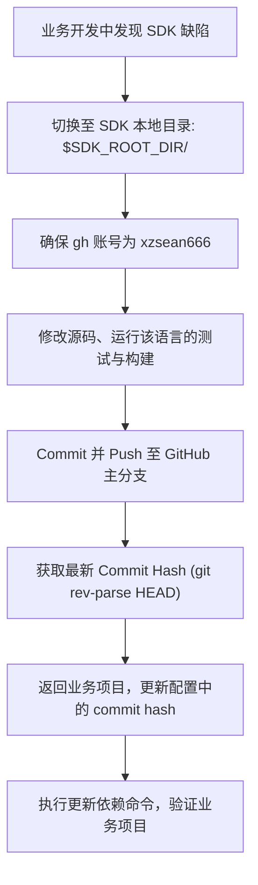

# 内部自研 SDK 依赖接入与协同维护规范 (Internal SDK Integration & Maintenance Guide)

> **适用对象**：所有接入内部自研 SDK 的业务项目（以 Node.js 为主，涵盖 Python、Rust、Go 等多语言栈）、开发人员以及 AI Agent 编程助手。  
> **文档目标**：统一内部基础库的路径规范、GitHub 账号认证、多语言依赖锁定、缺陷热修复更新流程以及 AI Skill 快速接入标准。

---

## 1. 基础配置与全局变量 (Configuration & Variables)

在将本文档引入新项目时，仅需确认或指定以下基础变量（默认指向当前服务器环境）：

```bash
# ==============================================================================
# [变量 1] SDK 本地源码根目录 (支持环境变量 SDK_ROOT_DIR 覆写，默认 /ssd0/git)
# ==============================================================================
SDK_ROOT_DIR="${SDK_ROOT_DIR:-/ssd0/git}"

# ==============================================================================
# [变量 2] 统一 GitHub 账号 (此目录下所有仓库统一绑定的 GitHub 账号)
# ==============================================================================
SDK_GITHUB_USER="xzsean666"

# ==============================================================================
# [变量 3] 本项目依赖的 SDK 目录清单 (仅需填写 SDK 目录名，其余由 AI 自动推导)
# ==============================================================================
DEPENDENT_SDKS=(
  "cloudlflare-worker-kvdb"
  "pay3"
)
```

### 1.1 AI 自动化识别与依赖解析准则 (AI Autonomous Detection)

> **原则**：开发者在此仅需提供 SDK 的目录名，**无需手动登记语言栈、Git 地址、包名或 Commit Hash**。AI Agent 接手项目后，必须自主探测并判断以下所有信息：

1. **自动判定语言技术栈与实际包名**：
   - 检查 `$SDK_ROOT_DIR/<sdk-dir>` 下的项目描述文件：
     - 存在 `package.json` -> 判定为 **Node.js**，直接提取其真实包名 `name`（例如 `kvdb-nodejs` 对应包名为 `kvdb-sdk`）。
     - 存在 `pyproject.toml` / `setup.py` -> 判定为 **Python**，提取其 package 名。
     - 存在 `Cargo.toml` -> 判定为 **Rust**，提取 crate 名称。
     - 存在 `go.mod` -> 判定为 **Go**，提取 module 路径。
2. **自动获取 Git 远端仓库地址与当前 Commit Hash**：
   - 自动执行 `git -C "$SDK_ROOT_DIR/<sdk-dir>" remote get-url origin` 确认远程地址。
   - 自动执行 `git -C "$SDK_ROOT_DIR/<sdk-dir>" rev-parse HEAD` 获取当前精确的 Commit Hash。
3. **自动配置业务项目依赖**：
   - AI 根据业务项目技术栈与 SDK 语言规范，自动生成并注入标准 Git+Hash 依赖（如 Node.js 的 `"pkg": "git+https://...#<hash>"`）。

---

## 2. GitHub CLI 账号与权限规范 (GitHub Auth)

`$SDK_ROOT_DIR`（默认 `/ssd0/git`）下的所有 SDK 仓库均统一托管于 **`xzsean666`** 账号。

### 操作规范：
所有涉及到 SDK 仓库的 Git 远程操作（`git push` / `git fetch` / `git pull`）或 GitHub CLI（`gh`）命令前，**必须确保当前活跃账号为 `xzsean666`**。

```bash
# 1. 检查当前活跃账号
gh auth status

# 2. 若当前账号不是 xzsean666，执行快速切换
gh auth switch --user xzsean666
```

> **原理说明**：推荐统一采用 `https://github.com/xzsean666/...` 协议。通过 GitHub CLI 的 Credential Helper，在 `gh auth switch` 后，标准的 Git 命令行能自动无缝继承该账号的鉴权凭据，无需维护多个复杂的 SSH Key 配置。

---

## 3. 项目依赖安装规范 (Git + Commit Hash)

为确保依赖版本的绝对可复现性并避免私有源发版成本，业务项目**统一使用 Git 仓库地址配合固定的 Commit Hash** 进行安装与锁定。

---

### 3.1 Node.js / TypeScript 技术栈 (主要应用场景)

#### `package.json` 配置模版
在业务项目的 `package.json` 中配置实际依赖的 SDK：

```json
{
  "dependencies": {
    "<package-name-1>": "git+https://github.com/xzsean666/<sdk-repo-1>.git#<COMMIT_HASH_1>",
    "<package-name-2>": "git+https://github.com/xzsean666/<sdk-repo-2>.git#<COMMIT_HASH_2>"
  }
}
```

> **构建机制说明**：
> Node.js SDK 仓库均配置了 `"prepare": "tsup"`（或类似构建脚本）。使用 `pnpm` 或 `npm` 安装 Git 依赖时，包管理器拉取后会自动在本地执行构建生成 `dist/`，无需在 Git 中预先提交编译产物。

#### 命令行安装与更新避坑 (避免命中 Git 缓存)
当更新了 Commit Hash 后，包管理器可能因为本地缓存未检测到变动，推荐使用显式命令安装更新：

```bash
# pnpm: 强制更新到指定 hash 并刷新 lockfile
pnpm add git+https://github.com/xzsean666/<sdk-repo>.git#<commit-hash>

# npm:
npm install git+https://github.com/xzsean666/<sdk-repo>.git#<commit-hash>
```

---

### 3.2 Python 技术栈

#### `requirements.txt` / `pyproject.toml` 配置模版
```text
# requirements.txt
<package-name> @ git+https://github.com/xzsean666/<sdk-repo>.git@<commit-hash>
```
或者在 Poetry / uv / PDM 中：
```toml
# pyproject.toml
<package-name> = { git = "https://github.com/xzsean666/<sdk-repo>.git", rev = "<commit-hash>" }
```

#### 命令行安装命令
```bash
pip install git+https://github.com/xzsean666/<sdk-repo>.git@<commit-hash>
# 或 uv
uv add "git+https://github.com/xzsean666/<sdk-repo>.git@<commit-hash>"
```

---

### 3.3 Rust / Go / 其他技术栈

- **Rust (`Cargo.toml`)**：
  ```toml
  <crate-name> = { git = "https://github.com/xzsean666/<sdk-repo>.git", rev = "<commit-hash>" }
  ```
- **Go (`go.mod`)**：
  ```bash
  go get github.com/xzsean666/<sdk-repo>@<commit-hash>
  ```

---

## 4. SDK 缺陷修复与热更新工作流 (Hotfix & Update SOP)

当在业务开发或调试过程中，发现底层 SDK 存在 Bug、功能缺失或类型定义不全时，**直接在本地执行同机热修复闭环，无需等待发版**。

### 标准修复步骤：



#### 具体操作指令：

1. **定位并进入 SDK 源码目录**：
   ```bash
   cd "$SDK_ROOT_DIR/<sdk-dir>"
   ```

2. **确认 GitHub 账号**：
   ```bash
   gh auth switch --user xzsean666
   ```

3. **修复代码并运行 SDK 测试与构建**：
   ```bash
   # 若为 Node.js SDK
   pnpm test && pnpm build

   # 若为 Python SDK
   pytest

   # 若为 Rust SDK
   cargo test && cargo build

   # 若为 Go SDK
   go test ./...
   ```

   > **调试加速技巧**：若需在业务项目中即时验证修改，可先临时在业务项目中软链本地源码（如 `pnpm link ../../<sdk-dir>` 或 `file:` 协议）进行单步断点与验证，待逻辑完全正确后再提交推送到 Git。

4. **提交代码并推送到远端主分支**：
   ```bash
   # 自动获取当前分支名 (main 或 master)
   BRANCH=$(git branch --show-current)

   git add .
   git commit -m "fix(sdk): 修复缺陷说明"
   git push origin "$BRANCH"
   ```

5. **获取最新的 Commit Hash**：
   ```bash
   NEW_HASH=$(git rev-parse HEAD)
   echo "最新 Hash 为: $NEW_HASH"
   ```

6. **同步回业务项目**：
   回到当前业务项目，将依赖配置文件（如 `package.json`、`requirements.txt`、`Cargo.toml`）中对应的 hash 替换为 `$NEW_HASH`，并更新依赖：
   ```bash
   cd /path/to/your/current-project

   # Node.js 显式重新安装指定新 hash:
   pnpm add git+https://github.com/xzsean666/<sdk-repo>.git#$NEW_HASH

   # Python:
   pip install -r requirements.txt

   # Rust:
   cargo update -p <crate-name>
   ```

---

## 5. AI Agent 接入规范：SDK Skill 文档协议 (AI Skill Integration)

为实现 AI Agent 无缝、零成本地理解并调用内部 SDK，**不论 SDK 使用何种语言编写**，均统一遵循以下文档规范：

### 5.1 文档路径约定
每个 SDK 的规范与使用说明存放于：
```text
$SDK_ROOT_DIR/<sdk-dir>/docs/AI/SKILL.md
```

### 5.2 AI Agent 接入执行准则 (SOP for AI Agents)

1. **优先读取 Skill 文档**：
   在业务项目中为用户编写或修改涉及该 SDK 的代码前，AI Agent **必须首先检查并读取**：
   ```text
   $SDK_ROOT_DIR/<sdk-dir>/docs/AI/SKILL.md
   ```
   读取其核心功能、最佳实践代码片段、初始化配置项及常见错误避坑指南。

2. **缺失时自动生成机制 (Auto-Generate if Missing - 核心规范)**：
   > **重要**：如果目标 SDK 目录下**尚不存在** `docs/AI/SKILL.md`，AI Agent **必须主动为该 SDK 分析源码并生成一份标准的 `docs/AI/SKILL.md`**，以便本次及后续项目能零成本接入。

   **AI 生成 `SKILL.md` 的标准步骤**：
   - **源码探查**：
     - **Node.js**: 分析 `package.json`（名称、导出入口）、`src/index.ts` 或 `dist/index.d.ts`（导出类、函数签名、类型定义）。
     - **Python**: 分析 `pyproject.toml`、`setup.py`、核心模块 `__init__.py`。
     - **Rust**: 分析 `Cargo.toml`、`src/lib.rs`。
     - **Go**: 分析 `go.mod`、根包公共函数与结构体。
   - **实测与样例挖掘**：查看 SDK 本地的 `tests/`、`test/` 或 `examples/`，获取经过验证的真实用法。
   - **创建并保存**：写入 `$SDK_ROOT_DIR/<sdk-dir>/docs/AI/SKILL.md`。可随后提交并推送至该 SDK 的远程仓库（确保账号为 `xzsean666`）。

### 5.3 标准 `SKILL.md` 生成骨架结构模版

AI Agent 在自动生成 `SKILL.md` 时，必须遵循以下标准结构模版：

````markdown
# <SDK_NAME> AI Skill & Integration Guide

> 本文档专供 AI 编程助手与开发者查阅，包含核心 API 签名、最佳实践与避坑指南。

## 1. 模块定位与核心能力
- **定位**：[一句话说明 SDK 核心解决的场景]
- **源码路径**：`$SDK_ROOT_DIR/<sdk-dir>`
- **依赖声明**：`git+https://github.com/xzsean666/<repo>.git#<commit-hash>`

## 2. 导出清单与核心 API (API Reference)
### 核心类 / 函数 / 模块
- `export class / function ...`
- **主要配置项 (Options)**：
  - `field`: 类型与含义

## 3. 快速上手完整用例 (Quickstart)
```typescript
// 最小可运行示例代码
import { ... } from '<package-name>';
...
```

## 4. 常见陷阱与最佳实践 (Pitfalls & Best Practices)
1. **[易错点 1]**：说明与正确姿势
2. **[易错点 2]**：超时、重试或异常处理注意项
````

---

## 6. 新项目快速接入模版 (可复制到业务项目的 AGENTS.md / README.md)

可以将以下精简模版直接粘贴至具体业务项目的 `AGENTS.md`、`README.md` 或项目 AI 规则中：

````markdown
### 内部自研 SDK 依赖说明
本项目依赖了位于 `{{SDK_ROOT_DIR:-/ssd0/git}}` 的内部自研基础 SDK：
- 依赖的 SDK 目录清单 (仅需列出目录名，具体语言/包名/commit-hash 由 AI 自动检测)：
  - <!-- 在此填写依赖的 SDK 目录名，如: evm-call, kvdb-nodejs -->

#### AI Agent 协同须知：
1. **自主解析与安装**：AI 负责自动探查 `$SDK_ROOT_DIR/<sdk-dir>` 下的项目描述（Node.js/Python/Rust 等），提取实际包名与最新 commit hash，自动生成并注入 Git+Hash 依赖。
2. **GitHub 账号规范**：涉及 SDK 的 GitHub 操作统一使用账号 `xzsean666` (`gh auth switch --user xzsean666`)。
3. **文档与 Skill 协议**：接入或使用 SDK 前，先检查并阅读 `{{SDK_ROOT_DIR:-/ssd0/git}}/<sdk-dir>/docs/AI/SKILL.md`。**若尚未生成，AI 必须自动分析 SDK 源码并生成标准的 `SKILL.md`**。
4. **同机热修复闭环**：若 SDK 功能有缺陷，直接前往 SDK 目录修复、跑测、push 并更新本项目的 commit hash。
````
