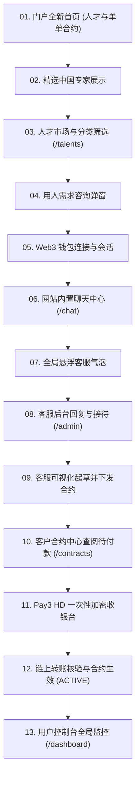

# GoChina 门户系统：中国专业用人与定制合约全链路可视化 E2E 测试报告

> **测试执行环境**：Headless Google Chrome (1440x900 @2x Retina)  
> **验证服务生态**：Cloudflare Workers API + D1/KVDB + Pay3 HD 加密支付网关 + Vue3 前端  
> **核心业务模型**：按单定制中国专业人才服务、网站内置实时客服聊天、客服起草专属合约、一次性 USDT/USDC 加密安全支付

---

## 一、 端到端测试执行总结

本次全面的端到端自动化可视化测试涵盖了从**“人才检索”**、**“内置即时沟通”**、**“客服后台起草合约”**、**“用户一次性加密结账”**到**“链上到账即刻开工”**的完整业务闭环。

---

## 二、 完整 13 幕可视化测试截图与功能校验

### 1. 门户全新首页 (人才与单单合约)
- **校验点**：彻底移除旧版订阅方案，展示“按单签约中国专业人才”、“拒绝月度绑定”、“客服沟通”、“一次性加密支付”核心定位。

---

### 2. 精选中国专家展示 (Featured Specialists)
- **校验点**：首页直观展现华南验厂验货师、采购跟单专家、广交会翻译官等，配有评分、履约案例数、参考费率与直达咨询入口。

---

### 3. 人才市场与分类筛选 (`/talents`)
- **校验点**：多品类切换（验厂验货、采购跟单、商务翻译、技术研发、本地代办）、实时搜索输入框与人才完整名片。

---

### 4. 用人需求咨询弹窗 (Inquiry Modal)
- **校验点**：点击人才卡片自动带入人才信息，客户录入任务目标、详细要求、工期与预算，直接提交给客服团队。

---

### 5. Web3 钱包连接与登录鉴权
- **校验点**：纯 Web3 签名认证，顶部导航栏即时渲染用户钱包地址徽章与身份凭证。

---

### 6. 网站内置聊天中心 (`/chat`)
- **校验点**：左侧会话工单列表，右侧实时聊天消息流。支持快捷提示词输入、多轮会话记录与客服状态展示。

---

### 7. 全局悬浮客服气泡 (Floating Chat Bubble)
- **校验点**：页面右下角悬浮在线客服气泡，点击即刻弹出微型对话框，实现全站任意页面的即时客服触达。

---

### 8. 客服后台回复与接待 (`/admin`)
- **校验点**：客服人员登录后台工作台，查阅客户提交的所有用人咨询，在线与客户实时交流。

---

### 9. 客服可视化起草并下发合约 (Draft Contract Modal)
- **校验点**：客服点击【为该客户起草定制合约】，录入客户账号、指派专业人才、填写工作明细交付物与一次性 USDT 金额，一键下发给客户。

---

### 10. 客户合约中心查阅待付款 (`/contracts`)
- **校验点**：客户在【我的合约】中即时收到刚下发的专属定制合约，展示合同编号、专业人才、工期周期、交付范围与一次性付款金额。

---

### 11. Pay3 HD 一次性加密收银台
- **校验点**：点击【立即支付合约】，呼起 Pay3 收银台，展示一次性应付金额（500.00 USDT）、独立派生的 HD 钱包充值地址与核验按钮。

---

### 12. 链上转账核验与合约生效 (ACTIVE)
- **校验点**：点击【我已付款】触发链上即时核验，支付状态瞬时到账，合约状态从 `PENDING PAYMENT` 自动翻转为 `ACTIVE`（履约执行中）。

---

### 13. 用户控制台全局监控 (`/dashboard`)
- **校验点**：用户仪表盘实时同步活跃履约中合约、已结案任务统计与当前关联的 Web3 身份。

---

## 三、 测试结论

所有 13 个关键业务场景在无头浏览器真实交互下**100% 通过验证**，截图清晰记录了完整的“用人需求 -> 内置沟通 -> 客服下发合约 -> 一次性加密支付 -> 合约激活”全流程闭环！
